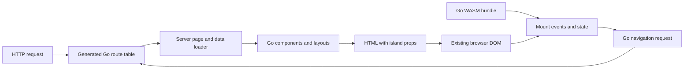

# Next.go

A Go full-stack web framework with server-rendered HTML, file routes, nested layouts, interactive WebAssembly islands, explicit caching, server actions, streaming boundaries, typed metadata, and local image optimization. Application logic and browser interactions are written in Go. JavaScript is limited to Go's required runtime support and a small bootstrap/development bridge.

**Experimental: feature parity and production maturity are unfinished.** The target is a Go alternative to Next.js, without React/JSX source compatibility. [The capability inventory and release gates](docs/PARITY.md) distinguish implemented subsets from remaining work. Native race tests, Chromium production/development/static-host suites and Firefox/WebKit production checks cover implemented subsets. Recorded integrated checks qualify their named source checkpoints; complete browser qualification, release security review, performance and operational release gates remain open.

`Page.DeferredMetadata` adds an owned late typed SEO-head contribution over a
complete fallback; initial HTML remains blocking by default. See the
[metadata contract and scoped verification](docs/METADATA.md).

The preceding resource, social-image, embed, asset-tool and inspection increment
has passing scoped qualification: 373 host browser checks and 44 Linux
cross-engine feature checks, both SDK native/WASM checks, 228 existing executable
checks and eight new local mock Lambda cases. These are separate result groups,
not real AWS or full release qualification. Historical ASCII-build and browser
results below describe their own checkpoints.

The preceding configuration-phase, managed-metadata and bounded-content increment
has passing native/WASM, focused example and final Linux metadata/CSS browser
checks for its bounded contracts. These are scoped results, recorded separately
in [the inventory](docs/PARITY.md), not full release qualification.

The preceding forms checkpoint adds choice/field validation and mutation
factoring. It passes both SDK/native/WASM and executable checks, 394 host
browser checks (335 primary, 36 forms, 23 separate static) and 48 Linux
four-engine form checks. The AWS qualification scaffold has offline tests only;
cloud execution was not authorized and has not run.

The preceding zones checkpoint composes exact-host/path-selected native applications
with explicit full-document boundaries and trusted tenant metadata. Native/WASM,
production, focused browser and four-engine Linux development checks pass for
this bounded subset. This is one-process composition, not independent application
releases or production tenant authentication. See [zones](docs/ZONES.md).

The preceding experimental refresh checkpoint implements explicit public state
cells in opted-in lazy components. Host development passes 33 checks; Linux
passes 88 unique four-engine checks (44 each on Go 1.24.13 and Go 1.27.3),
without failures, skips or retries in those completed runs. Eight separate warm
JSON archival checks pass and are not added to the 88. It is not full Fast
Refresh, arbitrary Go heap migration or production hot swapping. The separate
legacy 335-case host suite records 334
passes and one unresolved strict Chromium BFCache failure; no causal link or
fix is inferred.

The current independent-release/ingress source is implemented under
qualification. It separates selected application artifacts from trusted ingress
routing and retained release assets. Compiler isolation, rollout/rollback,
browser and transport proof is pending; no complete multi-zone or production
parity claim follows from the new APIs.

## Run the example

Install **Go 1.24+** for the minimum language/compatibility target. Use a
supported production SDK; the Docker build currently pins Go 1.27.3 and its
matching WASM support. See the [toolchain policy](docs/DEPLOYMENT.md#build-toolchain-policy).
Then run from this repository:

```sh
go run ./cmd/nextgo dev ./examples/demo
```

Open **http://127.0.0.1:3000** (or the address printed by the CLI). No Node installation, frontend build tool, or separate asset server is needed. The initial build compiles both targets and can take longer than subsequent builds.

The example includes:

| URL | Demonstrates |
| --- | --- |
| `/` | Shared root layout, meaningful SSR, two independent Go counters |
| `/about` | Static route and client-side navigation |
| `/prefetch` | Typed Go links, bounded production viewport prefetch and intent/none controls |
| `/resources` | Public SSR-seeded Go resources, explicit reload/retry and two owned views |
| `/social-image`, `/api/social` | Server-generated PNG card and social metadata |
| `/embeds` | Sandboxed local frame, native video/audio and captions |
| `/partial`, `/partial/alpha`, `/partial/beta` | Captured public shell and fresh request-time server regions |
| `/keyed`, `/keyed/table` | DOM-preserving keyed Go collections, row state, explicit updates and cleanup |
| `/composition`, `/composition/details` | Typed providers, child scopes, effects and retained-layout cleanup |
| `/forms` | Typed controlled inputs, validation, pending saves, cancellation and native POST fallback |
| `/field-preview`, `/form-pair` | Local controlled-field previews and independent reusable form models |
| `/choices`, `/choice-preview`, `/choice-pair` | Radio groups, multiple selects, native repeated fields and local previews |
| `/uploads`, `/file-preview` | Go file inputs, bounded binary reads, typed/native uploads and local previews |
| `/posts` | Server data loading and a nested layout |
| `/posts/html-first` | Dynamic `slug` parameter and an interactive island |
| `/posts?delay=750ms` | Cancellable server loading and navigation status |
| `/posts?fail=1` | Route error boundary |
| `/features` | JSON action, progressive HTML form, navigation/refresh controls |
| `/generated-actions` | Discovered typed JSON/multipart actions, native forms and explicit snapshot refresh |
| `/action-view` | Typed confirmation followed by a fresh streamed view in one POST |
| `/cookie-session` | In-progress native action cookies, signed-session login/logout and fresh authorization |
| `/lifecycle` | Bounded request completion callbacks |
| `/cache` | Server fresh/stale/hard-expiry snapshots and strict mutation publication |
| `/shared-cache` | Optional authenticated shared JSON data across app processes; background refresh and stale marking |
| `/shared-pages/alpha`, `/shared-pages/beta` | Optional shared public HTML/head snapshots, independently hydrated counters and acknowledged invalidation |
| `/evergreen` | Non-expiring default profile, bounded browser reuse, stale refresh and strict invalidation |
| `/profiles` | Named profiles, bounded Go browser reuse, stale publication, and mutation without page refresh |
| `/stream` | Early HTML shell and deferred Go-rendered island |
| `/metadata-stream` | Complete metadata fallback and deferred typed SEO head with retained Go state |
| `/transitions` | Native browser transitions for explicit Go state updates and optional navigation |
| `/boards/chart`, `/boards/settings`, `/boards/activity`, `/boards/drill`, `/boards/reports`, `/boards/reports/summary` | Named/implicit-primary slots, slot-only URLs, server defaults, retained Go islands and history selections |
| `/gallery`, `/photos/one`, `/photos/two` | Contextual Go dialogs, retained gallery state and standalone shareable photo URLs |
| `/rules` | Conditional routes, redirects and trusted external proxy examples (enable `NEXTGO_DEMO_RULES`) |
| `/docs/guide/getting-started` | Required catch-all route |
| `/catalog`, `/catalog/go/wasm` | Optional catch-all route |
| `/welcome` | URL-transparent route group |
| `/media` | Responsive local images and typed metadata |
| `/locale?lang=ar` | Explicit translated view, document direction, title template and viewport/theme settings |
| `/translations` | Go dictionary example; enable managed locales below for prefix/domain routing |
| `/sitemap.xml`, `/robots.txt` | Crawler resource handlers |
| `/missing` | Custom 404 with a real HTTP 404 status |
| `/api/health` | Ordinary Go HTTP API endpoint |
| `/downloads/report` | File-discovered HTTP handler outside `/api`, with method dispatch |

Disable JavaScript or delay the WASM request to inspect the initial HTML. Counters are disabled until hydration, while page content and ordinary links remain useful. After hydration, page links navigate without reloading the document. Page-local counters reset when their page is replaced. The demo opts into preserving shared layout islands. Its public server-action counter is process-local and resets at server restart; it demonstrates neither authentication nor persistent storage. Replace the illustrative `https://example.com` metadata origin before publishing.

To run the managed language-prefix example on a separate address:

```sh
NEXTGO_DEMO_LOCALES=true go run ./cmd/nextgo dev -addr 127.0.0.1:3020 ./examples/demo
```

Open `/fr/translations` or `/ar/translations`. `Config.Locales` supports language
prefixes, exact configured domains, explicit preference cookies and bounded
`Accept-Language` selection. Same-language links navigate in Go; switching locale
loads a fresh document. [Locale conventions](docs/LOCALES.md) cover URL helpers,
metadata, APIs/actions, domain trust and limits. Translations remain application
Go code. Deterministic locale subpaths can be statically exported with detection
disabled, including a separate artifact per selected configured domain;
negotiated static publication and full translation tooling are
unfinished.

## Build and deploy

```sh
go run ./cmd/nextgo build --out ./dist/demo ./examples/demo
./dist/demo/server -addr :3000
```

Pages that depend on runtime HTTP behavior can call `c.RequireServer()` before
returning and propagate its error. Export rejects the declaration before
publishing HTML/navigation bodies, preserving prior output. It is an explicit
dependency declaration, not automatic Go/API analysis. See
[static deployment dependencies](docs/STATIC_DEPENDENCIES.md).

`Config.Phase` distinguishes development, production, prerender capture and
static export before `Configure` runs. Export selects its own configuration and
cache identity, renders fresh output and leaves production private snapshot/seed
imports untouched. This is native startup purpose, not request authorization.
See [phase validation and isolation](docs/CONFIG_PHASES.md).

The controlled ASCII-validator build comparison reduces the Go 1.27.3 example
core from 8,689,715 to 8,191,328 raw bytes (2,233,505 to 2,107,698 gzip-9).
Both WASM size budgets still fail. [Paired artifacts and measurement limits](docs/PERFORMANCE.md#ascii-validator-build-comparison-october-25-2026-utc)
separate this bundle reduction from startup-speed and production-maturity claims.
The selected final checks record 828 browser passes and three existing platform
skips, alongside both SDK native/WASM and host/Linux deployment checks; this
does not complete the [release gates](docs/PARITY.md).

The output is a **single native server executable** containing public assets, WebAssembly, its matching `wasm_exec.js`, and the loader. Copy this executable to a compatible host and run it from any directory. Production needs neither Go nor Node installed. The default listen address is `:3000`; TLS can terminate at a reverse proxy.

The optional [Lambda ZIP target](docs/LAMBDA_PACKAGING.md) uses `go run ./cmd/nextgo build -target lambda -arch amd64 -out ./dist/lambda ./examples/demo` (or explicit `-arch arm64`). It packages a static Linux bootstrap and records artifact hashes and delivery limits. At source `452bca5d` (test merge `1748c45b`), its [four Linux SDK/architecture checks](https://github.com/Suhaibinator/Next.go/actions/runs/40514703903/attempts/1) passed generated-artifact race tests, vet and local mock Runtime API checks. This is component qualification; packaging performs no AWS calls or deployment.

[Deployment instructions](docs/DEPLOYMENT.md) cover reverse proxies, non-root read-only Docker, graceful shutdown, and an AWS Lambda HTTP API v2/Function URL adapter. Linux container and mock Lambda Runtime API checks exist; actual AWS deployment, IAM, cloud cold starts and platform behavior remain unvalidated. Lambda defaults to bounded buffered responses; optional true response streaming is implemented and mock-tested for compatible integrations. Actual AWS streaming and platform limits remain unverified. Default caches and example mutation state remain process-local. The optional [`cache/shared` API](docs/SHARED_CACHE.md) shares serialized data and explicitly selected public HTML/head snapshots through an authenticated HTTP backend. The service supports bounded memory or an optional Linux/macOS local file journal (`-data-dir`) with restart-safe values, deadlines and acknowledged invalidation. Shared prerender-seed admission has bounded native, browser and executable coverage; replication and real-cloud production qualification remain unfinished.

An [opt-in AWS qualification scaffold](deployment/aws-qualification/README.md)
prepares reviewed synthetic ZIP/template inputs and explicit account/profile/
budget controls. Its 18 offline tests do not qualify cloud behavior; cloud
execution was not authorized and no AWS calls have run. Operators must obtain
explicit approval before using its execution commands.

The binary targets the build machine's OS/architecture. Cross-platform native builds and Windows process supervision are not part of the tested v1 workflow. Builds use the current Go compiler for both targets; do not replace `wasm_exec.js` with a file from a different compiler version.

CLI flags precede the application directory:

```sh
go run ./cmd/nextgo dev -addr localhost:4000 ./examples/demo
go run ./cmd/nextgo build -out ./dist/site ./examples/demo
```

Generated sources and intermediate binaries live in `<app>/.nextgo/`. They are disposable and excluded from Git. Development retains the active generation and seven predecessors so documents can finish loading across rebuilds while disk usage stays bounded. Older generations expire; stopping the supervisor cleans its owned builds. A crash can leave disposable output to remove while development is stopped. Stop development before deleting this directory. Production output is under `dist/` by default.

## Create an application

From this framework checkout, create a **new** destination directory:

```sh
go run ./cmd/nextgo init -module example.com/myapp -framework . ./myapp
cd myapp
go run github.com/Suhaibinator/Next.go/cmd/nextgo dev .
```

The starter is an independent Go module with a shared layout, useful server HTML,
a Go/WASM counter, an about page, a dynamic greeting route, an API and custom 404.
It uses an explicit local framework replacement while this project is unreleased.
Keep the framework checkout available for builds; the production binary embeds
its runtime/assets and runs independently. Existing destinations are refused.
`nextgo help` lists commands; command flags precede the destination/application.
The generated starter has its own README and needs no Node installation.

## Application conventions

An application is a directory inside a Go module:

```text
app/
  layout.go                 Layout: shared outer wrapper
  page.go                   Page: /
  notfound.go               NotFound: custom 404
  about/page.go             Page: /about
  posts/
    layout.go               Layout: posts wrapper inside the root layout
    page.go                 Page: /posts
    param_slug/page.go       Page: /posts/:slug
  api/health/route.go        Handle: /api/health
  downloads/param_name/route.go  Handle: /downloads/:name
  templates/template.go     Template: segment-keyed wrapper
components/
  counter/
    props.go                Shared JSON-compatible props
    server.go               Server HTML component
    client_js.go            Browser Mount function
public/
  style.css                 Served as /assets/style.css
```

Development, build and export commands refresh an application-local `routes` package with typed URL constructors and decoded parameter readers. Run `go run ./cmd/nextgo generate ./examples/demo` for editor setup or add `--check` for CI drift detection. Dynamic segments use strings; catchalls use slices, with validation and per-segment escaping. See [generated Go routes](docs/TYPED_ROUTES.md) for examples, output ownership and naming limits.

Go import paths cannot use Next.js-style brackets. `param_slug` is a valid Go package directory that represents a dynamic segment. Directory names determine URLs; Go package names can differ. Each directory containing conventional files must be an importable Go package. Repeated parameter names and equivalent parameter routes such as `/posts/:id` and `/posts/:slug` are rejected. Matching prefers static segments at the first differing segment. Parameters match one segment; encoded slashes do not match. Trailing slashes redirect to the canonical path; `Config.TrailingSlash` enables slash-appending URLs, with file/service exceptions documented in [URL conventions](docs/URLS.md).

`/assets` and `/_nextgo` are framework-reserved prefixes. `/api` is reserved for HTTP handlers; pages cannot use it. Discovered `route.go` handlers may also live at other application paths.

Additional Go-safe conventions:

| File/directory | Meaning |
| --- | --- |
| `metadata.go` | `Metadata(*Context, seo.Metadata) (seo.Metadata, error)` contributes inherited server metadata |
| `unauthorized.go` / `forbidden.go` | 401/403 denial pages with safe outer layout prefixes; see [access conventions](docs/ACCESS.md) |
| `app/config.go` | `Configure(*nextgo.Config)` before server initialization |
| `docs/catchall_path/page.go` | `/docs/*path`, one or more segments |
| `catalog/optional_path/page.go` | `/catalog/*path?`, zero or more segments |
| `group_marketing/welcome/page.go` | `/welcome`, group omitted from URL |
| `posts/error.go` | `Error(*nextgo.Context, error) (nextgo.Page, error)` |
| `posts/loading.go` | `Loading(*nextgo.Context) (ui.Node, error)` |
| Nested `notfound.go` | Nearest matched-route `NotFound` boundary |

Catch-all parameters contain decoded segments joined with `/`; an optional empty match produces an empty string. Catch-alls terminate a route. Static segments precede single parameters, which precede catch-alls. Hidden directories are ignored; ambiguous route shapes and repeated parameter names are rejected.

The generator discovers the files above and emits ordinary typed imports and registration. Missing exports, wrong signatures, and invalid Go package imports produce Go compilation errors. There is no runtime Go source interpreter or compiler plugin.

### Typed navigation links

`ui.Link` renders a normal anchor and opts into bounded production viewport
prefetch by default. Plain `ui.El("a", ...)` links retain intent-only behavior:

```go
ui.Link(nextgo.MustURL(c, "/about"), ui.LinkOptions{}, ui.Text("About"))
ui.Link(nextgo.MustURL(c, "/partial/alpha"), ui.LinkOptions{
    Prefetch: ui.PrefetchIntent,
}, ui.Text("Load on pointer or keyboard intent"))
```

`PrefetchNone` disables automatic work for that link; `Replace` and ordinary
`Attrs` control history and native anchor attributes. Development/network/
lifecycle gates suppress viewport speculation without changing server privacy
or ordinary navigation. The current scheduler has two workers, 32 queued
candidates and bounded observation/deduplication. Its bounded subset passes
the current 232-check startup/viewport/partial-shell subset, both SDK native/WASM
and host/nonroot Linux executable checks; this is not a full release matrix.
[Startup ordering and evidence](docs/BOOTSTRAP.md) describe the tested artifact. See [API, lifecycle and limits](docs/VIEWPORT_PREFETCH.md).

### Pages and server data

`page.go` exports this signature:

```go
//go:build !js

package about

import (
    nextgo "github.com/Suhaibinator/Next.go"
    "github.com/Suhaibinator/Next.go/ui"
    "github.com/Suhaibinator/Next.go/seo"
)

func Page(c *nextgo.Context) (nextgo.Page, error) {
    // c.Context is the request cancellation context.
    // c.Params["slug"], c.Query.Get("q"), and c.Request are available.
    return nextgo.Page{
        Title:       "About",
        Description: "An application written in Go.",
        Metadata: seo.Metadata{Canonical: "https://example.com/about"},
        Body:        ui.El("h1", nil, ui.Text("Hello from Go")),
    }, nil
}
```

For an explicit compiler boundary, blank-import the appropriate marker:

```go
import _ "github.com/Suhaibinator/Next.go/serveronly" // database/server package
// Browser interop packages instead import .../clientonly.
```

`serveronly` has no JS implementation; `clientonly` has no native implementation.
Go rejects imports from the wrong target. Before building WASM, the CLI inspects
the actual transitive browser graph and rejects application `app/` packages and
component `server.go` files included in that target. Put `//go:build !js` before
the server file's package clause, and keep shared props in a separate file.
These checks follow explicit package/file boundaries; they do not infer whether
arbitrary shared fields or third-party dependencies contain application secrets.

Load data in the page function using `c.Context`; keep database credentials and server services in server-only packages. Return `nextgo.ErrNotFound` for a missing record. Other errors and page/layout/render panics select the nearest route `Error` boundary, or a generic 500 page, and log details on the server. Avoid exposing private error details in boundary output. Root `notfound.go` exports `NotFound(*nextgo.Context) (nextgo.Page, error)`. It owns its layout composition; see the example.

Pages handle GET and HEAD. A `route.go` may live at any unreserved application path, including dynamic/grouped paths; it cannot coexist with a page at the same URL. HTTP handlers bypass layouts and client link interception. They own their method handling, status codes, and serialization. `httpx.Methods` optionally dispatches a method table, derives HEAD from GET, sends automatic OPTIONS, and returns 405 with Allow for unsupported methods. They can read dynamic parameters with `r.PathValue("name")`:

```go
func Handle(w http.ResponseWriter, r *http.Request) {
    w.Header().Set("Content-Type", "application/json")
    json.NewEncoder(w).Encode(map[string]bool{"ok": true})
}
```

### Share loader work within a request

```go
posts, err := nextgo.Memo(c.Context, "posts:all", func(ctx context.Context) ([]Post, error) {
    return repository.All(ctx)
})
```

`Memo` shares concurrent calls, successful values and errors for one HTTP request.
Pages, layouts, API handlers and actions receive the same request scope. Keys must
include every loader input; callers treat returned values as immutable. Up to 128
keys of at most 1024 bytes are retained; values are not copied or byte-limited.
The loader receives the request deadline/cancellation and initiating context
values. Framework request contexts cancel when handlers return, including direct
embedding and Lambda. A shorter-lived waiter's cancellation leaves shared work available to
other callers. Forward the loader's supplied context to nested `Memo` calls so
cycles can be detected. Loader panics and premature goroutine exits return errors.
For isolated tests/services, install a scope with `nextgo.WithRequestMemo(ctx)`.
Public page-cache renders use a fresh scope instead of inheriting middleware's
memoized results. [The posts loader](examples/demo/data/posts.go) demonstrates
page/layout reuse. Cross-request data caching remains an explicit separate API.

### Layouts and reusable server components

`layout.go` exports `Layout(*nextgo.Context, ui.Node) (ui.Node, error)`. Layouts wrap the page from the innermost directory outward. `Config.PreserveLayouts` opts into retaining shared layout DOM and islands through generated layout identities/outlets. Preserve only content suitable for reuse: retained layout markup does not rerun to refresh request-dependent values. Leave the option disabled when each navigation must replace the whole layout. Page-local islands are disposed when their region is removed. A `template.go` exports `Template(*nextgo.Context, ui.Node) (ui.Node, error)` and renders inside its directory layout. With layout preservation enabled, its DOM and Go island state are keyed by the immediate child segment: changing that segment resets them; deeper segments and query changes retain them. Catch-all templates key all captured segments. An outgoing template disposes listeners before replacement. Without layout preservation, all wrappers remount on every page navigation. Independent route slots and retained whole-page state remain unfinished.

```go
func Layout(c *nextgo.Context, child ui.Node) (ui.Node, error) {
    return ui.El("main", ui.Attrs{"class": "container"},
        ui.El("nav", nil,
            ui.El("a", ui.Attrs{"href": "/"}, ui.Text("Home"))),
        child,
    ), nil
}
```

Reusable components are functions returning `ui.Node`. `ui.Fragment` groups children without a wrapper. Text and attributes are escaped; unsafe URL schemes, executable markup, inline event attributes and inline styles are rejected; responsive `srcset` is validated. Use static CSS in `public/style.css`. Rendering custom `ui.Node` implementations is a trusted-code escape hatch: the implementation must produce safe HTML itself. `ui.RenderContext(w)` exposes the current rendering context; use `ui.RenderTo(ctx, w, node)` when propagating it through custom rendering. Ordinary components should compose nodes directly so nested slot ownership remains visible to the renderer.

`public/` is copied into the build and served under `/assets/`; its contents are public. Asset symlinks are rejected. The document shell references `/assets/style.css` by convention. Framework runtime assets have versioned immutable URLs. Public assets use regular HTTP file-server behavior. HTML/navigation use `no-store` by default; explicitly public page policies can opt into bounded caching. gzip negotiation is enabled by `nextgo.New`; see [HTTP compression semantics](httpx/README.md).

### Interactive components

The server renders an island's initial HTML and JSON-compatible public props:

```go
return ui.Island("counter", props,
    ui.El("section", nil,
        ui.El("output", ui.Attrs{"data-count": ""},
            ui.Text(strconv.Itoa(props.Initial))),
        ui.El("button", ui.Attrs{"data-increment": "", "type": "button"},
            ui.Text("+"))),
)
```

The name is the component's path relative to `components/`. The generator registers every discovered `client_js.go`. Props are visible in the HTML: **never serialize secrets into them**.

`client_js.go` has the `js && wasm` build constraint and exports:

```go
func Mount(s *client.Scope, raw json.RawMessage) error {
    props, err := client.DecodeProps[Props](raw)
    if err != nil { return err }
    output, err := s.Require("[data-count]")
    if err != nil { return err }
    button, err := s.Require("[data-increment]")
    if err != nil { return err }

    state := client.NewState(props.Initial)
    s.Cleanup(state.Subscribe(func(n int) {
        output.Text(strconv.Itoa(n))
    }))
    s.On(button, "click", func(client.Event) {
        state.Set(state.Get() + 1)
    })
    return nil
}
```

See the counter example for complete server/browser files, initial-state validation, reset/decrement controls, and disabled-state handling.

`Scope.Require` queries within the current island, excluding nested islands. Validate all expected nodes before changing them. `Element.Text` leaves matching content alone and updates a sole text node in place when its value changes. `Element.Property`, `Element.Attribute`, and `Element.Value` expose explicit DOM updates. This API does not reconcile or rerender a tree. Keep state operations on the WASM event loop; state is not a concurrent native store.

For dynamic lists, [keyed collections](docs/KEYED_COLLECTIONS.md) bind row scopes to existing `ui.Keyed` elements. `client.HydrateKeyed` validates SSR order; `Set` retains keyed nodes/state, moves existing rows, creates additions and disposes removals. Row views and update callbacks stay in Go. See `/keyed` and `/keyed/table` for runnable list and table examples, limits and failure behavior.

`Scope.On` owns each Go/JS event callback. `Scope.Cleanup` owns subscriptions and other resources. Leaving the page disposes these resources before removing its DOM. Prefer `client.Fetch` for browser HTTP work; it avoids linking Go’s larger `net/http` dependency graph into WASM. Start asynchronous work in a goroutine from the event callback and cancel it through scope cleanup. Browser event callbacks must return promptly.

[Component lifetimes](docs/COMPONENT_LIFETIMES.md) add `Scope.Subscope` for child ownership, typed `NewContext`/`Provide`/`UseContext` providers, and `Lifetime.Effect` with explicit state dependencies and cleanup before each rerun. Preserved layout scopes retain their providers; replaced page scopes dispose them. Context stays within one Go ownership tree/runtime, and effects run synchronously without implicit dependency tracking.

[Controlled forms](docs/FORMS.md) use typed Go inputs, explicit field bindings and one cancellable submission. They preserve pre-WASM edits, keep newer edits during delayed responses, expose validation and unknown outcomes, and retain ordinary POST behavior. Additive `RadioChoice`/`BindRadioChoice` distinguishes absence from a selected empty value; `BindMultipleOptions` uses option indices to preserve duplicate-valued node identity. `SelectedOptionValues` preserves native value multiplicity without inventing an index roundtrip from repeated POST strings. Legacy value-based bindings keep their existing contracts.

`Form.Validate`/`ValidateOnBlur` remain synchronous. Opt-in
`BindFieldValidation` adds explicit input/blur/manual triggers, debounce and
stale-result tickets; binding starts no work. Logical pending checks gate
submission, and canceled callbacks retain physical admission until return.
The document defaults to eight validator callbacks and 128 controllers across
eager/lazy runtimes. Server validation and authorization remain mandatory.
Run `go run ./cmd/nextgo dev ./examples/form-validation` for two independent
public preview forms; see [field validation](docs/FIELD_VALIDATION.md) and
[the sample contract](examples/form-validation/README.md). No persistence or
production authentication is provided.

[File inputs and uploads](docs/FILES.md) bind browser-local `client.File` handles, read bounded bytes with cancellation, and preserve native multipart POST. Go browser components can use [native multipart transport](docs/MULTIPART.md) to upload through FormData without copying contents into Go or base64 encoding. The small-file sample hashes and discards bytes; its public receipt metadata is process-local. Streaming, resumable uploads and object storage remain open.

For example, bind the request lifetime to the island:

```go
ctx, cancel := context.WithCancel(context.Background())
s.Cleanup(cancel)
s.On(button, "click", func(client.Event) {
    go func() {
        response, err := client.Fetch(ctx, "/api/health", client.FetchOptions{
            MaxBytes: 64 << 10, Cache: "no-store",
        })
        if err != nil || ctx.Err() != nil { return }
        // Check response.StatusCode and decode response.Body in Go.
        _ = response
    }()
})
```

`FetchOptions` also accepts `Method`, `Headers` and binary `Body`. The result has `URL`, `StatusCode`, case-insensitive `Header`, and `Body`; HTTP error statuses return normally. The default decoded-body limit is 8 MiB. Context cancellation aborts both the request and its reader while callbacks remain valid until Promise settlement. `net/http` is still available when desired, with its bundle-size cost. [Performance documentation](docs/PERFORMANCE.md) records the API, historical reference builds and current lazy-module measurements. The current Go 1.27 demo exceeds the proposed eager bundle-size budget, and using a lazy component adds a separate runtime download. These artifact-specific measurements are not Next.js comparisons or production performance guarantees.

Keep server render code in `//go:build !js` files and browser code in `//go:build js && wasm` files; props can compile for both. The filename `server.go` alone is not a Go build constraint. Generated browser entrypoints import only discovered component packages and the client runtime, not page/loader packages.

## Configuration, caching, and server actions

The optional root `app/config.go` exports `Configure(*nextgo.Config)`. Generated entrypoints invoke it before server initialization. Configure headers, middleware, local redirects/rewrites, explicit handlers, `Actions`, `Images`, a process-local `Cache`, `PreserveLayouts`, `ViewTransitions`, and individual route cache policies:

```go
func Configure(c *nextgo.Config) {
    c.Headers = http.Header{"X-App": {"example"}}
    c.Redirects = []nextgo.RedirectRule{
        {Source: "/old/:slug", Destination: "/posts/:slug", Permanent: true},
    }
    c.Rewrites = []nextgo.RewriteRule{
        {Source: "/notes/:slug", Destination: "/posts/:slug"},
    }
    c.Middleware = append(c.Middleware, func(next http.Handler) http.Handler {
        return http.HandlerFunc(func(w http.ResponseWriter, r *http.Request) {
            next.ServeHTTP(w, r)
        })
    })
    for i := range c.Routes {
        if c.Routes[i].Pattern == "/posts" {
            c.Routes[i].Cache = &nextgo.CachePolicy{
                TTL: time.Minute, Tags: []string{"posts"},
            }
        }
    }
}
```

Redirect/rewrite rules use route-style parameters, Has/Missing header/cookie/query/host conditions, and local or literal HTTP(S) destinations. `BasePath`, `AssetPrefix` and `TrailingSlash` configure deployment URLs; [URL conventions](docs/URLS.md) cover server/browser helpers, endpoint behavior, asset-only serving and static output. External rewrite proxying is implemented with shared concurrency/body/time budgets and explicit credential/forwarding policy; [request-rule conventions](docs/REQUEST_RULES.md) describe captures, private cache behavior, external document boundaries, static-export restrictions and remaining phase/query/deployment limits. Middleware wraps the router in configured order. Page/layout/boundary code can stage response controls through `Context.SetHeader`, `AddHeader`, `SetCookie`, `SetStatus` and `Redirect`. Check returned errors and call them before returning; controls seal before rendering, so deferred loaders cannot change committed headers. `Context.Redirect` requires application-relative absolute paths and does not stop Go execution. Cookies force private/no-store; public-cache loaders reject response mutations even if the caller ignores the error. Use explicit handlers for arbitrary response bodies or framing.

Page caching is **explicitly public**: enable it only for anonymous, request-independent output. Development, Cookie/Authorization requests, errors and streamed pages bypass it. Cache keys include build, host and request URI. A policy is a public-data assertion, not automatic personalization detection: applications must account for any other result-affecting headers or inputs. Call `App.RevalidateTag`/`App.RevalidatePath` after a successful mutation, or invalidate the same process-local configured store. Invalidation affects this process, not every browser/CDN or server instance.

For independently cached data:

```go
var store = cache.New(512)

posts, err := cache.GetOrLoad(ctx, store, "public-posts:v1", cache.Options{
    TTL: time.Minute, Tags: []string{"posts"}, Paths: []string{"/posts"},
}, loadPosts)
```

The store supports bounded LRU entries, TTL, concurrent-load coalescing, independent waiter cancellation and key/tag/path invalidation. `ExpireKey`/`ExpireTag`/`ExpirePath`/`ExpirePathPrefix`/`ExpireAll` additionally cancel obsolete loads and move outstanding readers to a new generation, including completed results not yet delivered. `App.RevalidateTag`/`App.RevalidatePath` use this stricter behavior; commit backing writes first and use read-only, cancellation-aware loaders. Ordinary `Invalidate*` methods allow existing readers to finish with old data. Values are shared references, immutable by convention; `WithMaxBytes` adds an accounted payload budget to the entry-count limit. Include tenant/user/filter/authorization inputs in private keys. [Cache documentation](cache/README.md) defines delivery ordering, cancellation, concurrency and multi-instance limits. Opt-in `cache.Lifetime` adds server revalidation/expiry ages with coalesced refresh, last-good fallback, hard-expiry blocking and bounded `nextgo.CacheRefresh` lifecycle work. `CachePolicy.Lifetime` applies this to complete public snapshots; those responses stay no-store for browser/CDN reuse. `Config.CacheProfiles` and `CachePolicy.Profile` add named policies with explicit Go browser ages, bounded by generation age and hard expiry. Intermediaries must revalidate; `client.Fetch` framework-action POSTs discard Go reuse at dispatch and settlement. `nextgo.LookupCacheProfile` exposes effective values to server data work. `App.RevalidateTagProfile`/`App.RevalidatePathProfile` and data-store `MarkStale*` methods optionally retain a last-good value while a later read refreshes it, bounded by the original hard deadline and the requested window. `cache.Never` disables only a server lifetime/marking hard deadline; the explicit `default` profile uses five-minute browser and fifteen-minute revalidation ages without hard expiry. Storage limits and error/expiration policies still apply. `Config.CacheProfileSpecs` and inline `CachePolicy.ProfileSpec` add partial definitions that inherit the effective default; explicit zero values retain their meaning, inputs are frozen at startup, and equivalent resolved policies share a cache identity. Nested lifetime propagation, implicit cached-function scopes, complete distributed invalidation and replicated ISR remain unfinished. Explicit authority-admitted build seeds have a separate tested, bounded contract.

Register explicit mutation handlers with the `actions` package and assign the router to `Config.Actions`:

```go
router := actions.New(actions.Options{})
router.Handle("save", func(c *actions.Context) (actions.Result, error) {
    form, err := c.ParseForm()
    if err != nil { return actions.Result{}, err }
    // Authenticate, authorize, and validate before a real mutation.
    if strings.TrimSpace(form.Get("name")) == "" {
        return actions.Result{}, &actions.ValidationError{
            Message: "Name is required.", Fields: map[string]string{"name": "Required"},
        }
    }
    return actions.Result{Redirect: "/saved"}, nil
})
config.Actions = router
```

An ordinary `method="post" action="/_nextgo/actions/save"` form works without WASM; successful local redirects use 303. JSON handlers use `DecodeJSON` and `Result.Data`; the sample Go toolbox invokes JSON actions, then navigates or refreshes. This is explicit HTTP dispatch, not generated remote Go closures or a one-response streamed UI mutation protocol.

Action requests accept POST only, bound bodies to 1 MiB by default, reject cross-origin browser requests, validate redirects and hide unexpected errors. [Action security/HTTP documentation](actions/README.md) describes Origin/Referer/Fetch Metadata checks, proxy `AllowedOrigins`, validation and multipart cleanup. Origin checks do not authenticate users. Wire `Options.OnRevalidate` to the process-local configured cache after successful mutations, as [the sample configuration](examples/demo/app/config.go) does. Persistence, transactions, retry deduplication and authorization belong in the application.

### Generated action references

Put shared `Input`/`Output` and a literal, versioned `mutation.Contract` in
`actions/<name>/contract.go`, with native-only `Handle`/`Options` in `action.go`.
`nextgo generate` discovers these declarations without executing application
code and emits shared path/type aliases, named Go/WASM calls and native
registration in `actionrefs`. The CLI attaches registration to an app-owned
router clone; existing manual actions and configured router hooks remain usable.

Try `/generated-actions`, or run
`go run ./cmd/nextgo generate --check ./examples/demo` to check owned outputs.
Generated calls reuse the typed mutation transport; UI refresh, navigation,
authorization and persistence remain explicit application decisions. This new
subset passes 35 generated-action checks, 138 affected regressions and 20 Linux
parser checks (193 distinct local cases). Native race/vet and matching WASM
tests/vet pass on both SDKs, alongside host/Linux executable suites. The measured bundle still exceeds
both reference size budgets; remote CI retains its separate failed action step.
See [conventions, provenance and startup guarantees](docs/GENERATED_ACTIONS.md).

### Confirm an action and refresh its view

The new `CallAndRefresh`/`CallMultipartAndRefresh` contract methods and generated
`FooAndRefresh` wrappers negotiate typed confirmation plus fresh server UI in
one POST. A nil top-level error confirms `Data` even if `View.Err` reports a
failed/superseded refresh: keep the data and reconcile separately, never repeat
a confirmed mutation to repair its view. Ordinary `Call` APIs still return typed
data without automatically refreshing the view; they now share the dispatch FIFO.
The preceding action-view checkpoint passed 75 focused cases plus 179 affected host regressions
(254 distinct local checks), both SDK native/WASM checks and host/Linux
HTTP/both mock Lambda suites. Preceding matrices stay separate. Try `/action-view`
and read [qualification, ownership, cookies and failure rules](docs/ACTION_VIEWS.md). Native
result cookies and a document-wide typed-dispatch FIFO are implemented
with scoped verification. Both SDK native/WASM and full host/Linux deployment
checks pass; all 55 cookie cases pass. The corrected affected browser matrix
passes 342/342, including 75 action-view checks. A native JavaScript CDP
reproduction retains a separate underlying-cause investigation. See
[native cookies/session limits](docs/NATIVE_COOKIES.md)
and [dispatch/cancellation](docs/MUTATION_DISPATCH.md). Previous matrices do not
qualify this new phase; complete session/revocation/refresh behavior remains open.

## Streaming, metadata, images, and static export

Set `Page.Stream: true` and describe a deferred server boundary:

```go
Body: ui.El("main", nil,
    ui.El("h1", nil, ui.Text("Useful initial content")),
    ui.Defer("details", ui.Text("Loading details…"),
        func(ctx context.Context) (ui.Node, error) {
            // Honor ctx; also capture request context for ordinary rendering.
            return ui.El("p", nil, ui.Text("Deferred content")), nil
        }),
),
```

Full-document requests flush the initial shell and later inert templates. Go/WASM waits for each template's matching outside completion marker before moving its existing nodes into the boundary and hydrating its islands; no executable inline patch scripts are generated. The fallback remains visible while the HTML parser has only part of a chunk. **Deferred chunks require WASM to become visible**; the no-script view keeps fallback content. Negotiated navigation commits a validated shell, then independently nested chunks as they arrive. Older clients still receive complete buffered envelopes. Explicit partial shells with registered request-time regions are available; automatic partial-shell analysis, metadata streaming and independent route/slot ownership remain unfinished. Failures after headers flush use generic boundary error content. See [the streaming sample](examples/demo/app/stream/page.go) and [completion contract](docs/STREAMING.md#initial-document-completion).

`seo.Metadata` supports canonical links, robots, language alternates, icons, Open Graph and Twitter fields. `metadata.go` providers merge ancestor contributions automatically, share request Memo data, and support trusted `BaseURL` resolution. `TitleTemplate` formats explicit descendant titles; `AbsoluteTitle` bypasses it. Typed `Language`, `Direction` and `Viewport` settings cover document attributes, zoom/fit/widget policy, color scheme and media-conditioned theme colors. These settings render before WASM and update during navigation; `/locale?lang=ar` demonstrates explicit translated views. `seo.Merge(parent, child)` remains a pure value merge; `seo.ResolveContribution` adds title formatting. [Metadata conventions](docs/METADATA.md) describe precedence, validation, cache/privacy rules and current limits. `seo.Sitemap`, `seo.SitemapIndex` and `seo.Robots` create validated handlers for `Config.Handlers`. Managed prefix/domain routing now supplies locale defaults and trusted URL helpers; see [locale conventions](docs/LOCALES.md). Metadata streaming, broader metadata-file conventions, automatic font download/subsetting and broader script integration remain outstanding. Local font/stylesheet resources are available through the assets API below.

Managed app-root metadata discovers six explicit public files (`robots.txt`,
`sitemap.xml`, `favicon.ico`, `icon.png`, `apple-icon.png`,
`manifest.webmanifest`) and optional native `Robots`, `Sitemap` and `Manifest`
startup factories. They publish global mounted public bytes, independent of
request cookies, locale negotiation and asset CDN prefixes. These paths bypass
page middleware, rewrites and draft binding; declare only public bytes. Typed head defaults
can inherit, override or clear icon/manifest groups. Export validates the
declared version-2 inventory before publication. See
[metadata format/trust limits](metadatafiles/README.md) and the styled
[metadata example](examples/metadata-site/README.md).

`content.Parse` renders an explicit bounded Markdown subset through escaped
`ui.Node` values, with no raw HTML, document code or implicit file/network load.
Compose trusted Go components around the result. It is neither CommonMark nor
MDX; the [syntax and limits](docs/CONTENT.md) and styled
[content example](examples/content/README.md) describe native/static use.

`socialimage.Render` and `socialimage.NewHandler` compose bounded typed layouts, bitmap
text and supplied image bytes into PNGs using Go's standard library. The
`/social-image` example uses `/api/social` for its card metadata. This is not an
HTML/CSS/JSX layout engine or automatic image-file publication. See
[social-image rendering, caching and limits](docs/SOCIAL_IMAGES.md).

`ui.FramePolicy` permits configured literal origins or explicit self sources,
with an empty sandbox by default and a persistent fallback. `ui.Video` and
`ui.Audio` provide typed native controls, source validation and text tracks.
General iframe/raw HTML restrictions remain intact; applications own CSP,
trusted providers and media assets. See [frames and native media](docs/EMBEDS.md).

`images.New(images.Config{FS: publicImages})` creates a local public-image optimizer. Assign it to `Config.Images`, then render `handler.Image(images.ImageOptions{Src: "/photo.png", Alt: "A landscape", Width: 960, Height: 640})`. It supplies intrinsic dimensions, responsive variants and lazy-loading attributes, with configured input/pixel/dimension/concurrency and encoded-cache limits. Current output formats are PNG/JPEG; remote fetching, WebP/AVIF and automatic blur placeholders are unfinished. An image `os.DirFS` must not expose secrets or symlinks escaping its public root. See [the embedded image/crawler setup](examples/demo/media/assets.go) and [media page](examples/demo/app/media/page.go).

Page resources declare additional local stylesheets and font preloads:

```go
page.Resources = []assets.Resource{assets.Stylesheet("/assets/detail.css")}
font := assets.Font{Family: "Example", Source: "/assets/example.woff2", Format: "woff2"}
handler, fontCSS, err := assets.NewFontStyles([]assets.Font{font})
if err != nil { panic(err) } // Example startup configuration.
config.Handlers[fontCSS] = handler // Initialize the map if needed.
page.Resources = append(page.Resources, assets.Stylesheet(fontCSS), font.Preload())
```

`NewFontStyles` validates local WOFF/WOFF2 faces and creates content-addressed CSS; the font bytes themselves must exist at the public source URL. Font weights/styles/display and metric overrides can be configured. `Page.Resources` is validated with metadata before rendering/caching. Native head/resource tests and the Chromium stylesheet navigation/cleanup regression pass; font acquisition and real font-loading/layout-shift qualification remain separate. This does not download/subset fonts or implement a third-party script loader.

Optional `nextgo.assets.json` commands run declared CSS/asset tools during
development, build and export. Watched input snapshots and validated staged
outputs enter the successful generation; ordinary Go applications need no
Node/tooling manifest. Commands run with the user's privileges, not in an OS
sandbox. The [Go token/CSS example](examples/css-pipeline) and
[asset-pipeline contract](docs/ASSET_PIPELINE.md) cover hooks, bounds, cache
policy and static-host responsibilities. Manifest v2 adds explicit dependency
aliases and private intermediate outputs: the example normalizes token JSON,
then renders only the final stylesheet. Dependencies run in stable topological
order from isolated verified copies; imports are not inferred. See
[asset dependency chains](docs/ASSET_DEPENDENCIES.md) for bounds and compatibility.

The static exporter supports concrete pages, bounded parameter enumeration and deterministic locale subpaths. Broader static-generation semantics remain partial:


```sh
go run ./cmd/nextgo export -out ./dist/static \
  -paths /about,/welcome,/docs/guide ./examples/demo
```

It emits concrete HTML, navigation JSON and assets for a static HTTP host. `-paths` supplies concrete logical application URLs; without it, static pages and `StaticParams` results are selected. In deterministic locale mode (`Detect: false`, no domains or an explicit `-domain` selection), logical selections expand across languages and navigation data is published under each language prefix. [Locale export details](docs/LOCALES.md) explain scope identities, static manifests and hosting limits. Pages containing server actions, optimized-image endpoints or streamed chunks are rejected, so the complete feature demo cannot be exported unchanged. Runtime mutations/APIs and request-dependent data do not become available on static hosting. Serve exported directories through HTTP, not `file://`.

### Build-time dynamic parameters

A dynamic page package can add `staticparams.go` (server-only) to enumerate its
public build-time URLs:

```go
//go:build !js

package slug

func StaticParams(ctx context.Context) ([]nextgo.Params, error) {
    posts, err := data.All(ctx)
    if err != nil { return nil, err }
    params := make([]nextgo.Params, 0, len(posts))
    for _, post := range posts {
        params = append(params, nextgo.Params{"slug": post.Slug})
    }
    return params, nil
}
```

Use the standard `context` and framework imports in that file. Parameter values
are decoded strings; catch-alls use slash-separated segments, and an optional
catch-all may be absent or empty. Each page supplies every parameter in its full
route. An enumerator is not inherited from a parent segment. Unknown/missing
parameters, unsafe segments and paths shadowed by a more-specific route fail
with a diagnostic. Static/API/orphan `staticparams.go` files are rejected.

Without `-paths`, `nextgo export` includes static pages and these enumerated
paths. Explicit `-paths` overrides that selection. The generated binary also
supports `-static-paths` to write the sorted JSON list and exit without listening;
`app.StaticPaths(ctx)` provides the same capability in a custom server. Keep
application diagnostics on stderr when using this machine-readable command.
Enumeration has cancellation, row/path/byte limits and a 30-second CLI deadline;
a noncooperative callback is terminated with its exporter subprocess. Parameters
are public build data. They must not contain secrets or personalized output.

This prepares static exports. `nextgo build` still produces a request-rendered
server; it does not yet create a hybrid prerender/ISR cache. Missing dynamic paths
are omitted from a static export and cannot be generated on a plain static host.
Request-dependent loader detection and incremental regeneration remain open.

## Named parallel routes

`slot_name` directories declare named server-page branches alongside a primary
page. Their parent layout composes `c.Slot("name")` with its children. Direct
loads select matching branches or `default.go`; soft navigation can retain an
unmatched slot after server reauthorization and content-hash validation. Visit
`/boards/chart`, increment the analytics counter, then select Settings. Increment
the primary chart counter and select Activity to retain the primary page at a
slot-only URL; reload Activity to receive the primary default. Named defaults
inherit slot-local layouts, templates, metadata providers and error/404 boundaries;
the analytics shell counter survives matching/default branch changes and history.
Named slots nest inside other slots and retained primary layouts. Select Drill
to update the nested detail branch while retaining both primary selections;
Reports demonstrates a named slot inside a retained primary page. Summary
composes two primary-default owners in the same layout chain; each owner retains
and revalidates its selected branch independently.

Layouts can read `c.Selection("children")` or a named slot selection and pass its
opaque scope to a Go island. `scope.ObserveSelection` updates active-tab indicators
inside retained layouts and unsubscribes when an island is disposed. Boards and
reports display these values in SSR and after navigation. Logical segments exclude
queries and transparent route groups; catch-all values are joined into one segment.

[Parallel-route conventions](docs/PARALLEL_ROUTES.md) cover defaults, history,
response/cache/authorization boundaries and the current limits. Independent
streaming and slot head composition remain unfinished.

## Intercepting routes

The [intercepting-route example](docs/INTERCEPTING_ROUTES.md) opens a photo from
`/gallery` in a native dialog powered by Go. Close/Escape/back restore the gallery;
forward reopens the photo, and a reload serves its standalone page. The server
reauthorizes both branches before retaining state. `intercept_root` directories
declare absolute targets inside a named slot. Nested named-slot owners, slot head
composition and complete production accessibility/resource qualification remain open.
Refresh inside the modal preserves unchanged Go state and rechecks access. Changed
photo output replaces its own islands while the gallery remains mounted. The
router rejects ambiguous background hints and applies target specificity across slots.
The replace-open link demonstrates `data-nextgo-replace="true"`. Modal dismissal
uses `client.BackOrReplace` with `Context.InterceptedFrom`: a tracked matching
previous entry goes back; otherwise the current entry is replaced with its background.

## Browser view transitions

Set `Config.ViewTransitions = true` or run the example with
`NEXTGO_DEMO_VIEW_TRANSITIONS=true` to animate Go navigation. Server HTML and
hydration remain unchanged. The Go runtime respects reduced motion, skips
superseded animations and falls back to ordinary DOM updates when snapshots are
slow or unavailable. Links and `NavigateWithOptions` can opt out or supply
transition types. `client.Transition` wraps an explicit component update with a
cancellable native transition. [Transition conventions](docs/TRANSITIONS.md)
cover CSS, lifecycle, static export, streaming and the remaining parity limits.

## Server tracing

Opt in through `Config.Tracing` or run the demo with
`NEXTGO_DEMO_TRACING=true`. Standard-library tracing correlates middleware,
load/cache, render, API/action, outbound HTTP and accepted completion work.
The built-in recorder writes structured JSON without automatically including
URLs, query/parameter values, headers, bodies or error messages. Incoming
version-00 trace context requires explicit trust; it is ignored by default.

[Tracing conventions](docs/TRACING.md) cover custom spans, sampling, recorder
failures, HTTP interface/body lifecycle and Lambda acceptance. Recorders are
synchronous and must return promptly. The optional [OTLP/HTTP JSON exporter](telemetry/otlp/README.md)
provides bounded asynchronous admission, batches/retries, loss counters and
flush/shutdown hooks using standard-library dependencies. Set
`NEXTGO_DEMO_OTLP_ENDPOINT=http://127.0.0.1:4318/v1/traces` to use it in the demo.
An official pinned collector and generated HTTP/both-Lambda fixtures verify
local delivery and completion draining. Full OpenTelemetry SDK/semantic support,
metrics, browser/build spans and production exporter/load qualification remain
unfinished.

## Rendering and navigation architecture

An experimental [managed offline mode](docs/OFFLINE.md) builds a Go/WASM service
worker and complete immutable dependency inventory, then prepares explicitly
allowed anonymous public documents once at production startup. Eager Go controls
enable saving, check updates and disable the owned worker. Saved reading uses
native document navigation; private/query/API requests and mutations remain
network-only. Open tabs can defer deletion after disable. A bounded matrix of 32 browser cases
across four engines passed cold restart, Go hydration, updates and explicit
cleanup controls. Arbitrary offline applications and durable Go scheduling remain
unqualified. See the [offline example](examples/offline/README.md) for the
production build command and the guide for v1 restrictions. This bounded
subset does not preserve authenticated current state or replay mutations.



An ordinary request returns a full HTML document. A Go navigation request sends `X-Nextgo-Navigate: 1` and receives JSON containing `version`, `build`, `configuration`, `url`, `html`, `title`, `description`, `meta`, `document`, `status`, and optional structured `head`. `document` carries required `lang`, `dir` and `viewport` values. The final server URL keeps browser history canonical after redirects; the browser preserves the target fragment. Both responses retain the proper HTTP status. The current envelope has `version: 3` and requires `X-Nextgo-Protocol: 3` on live server responses. This is an internal, version-checked protocol; incompatible responses trigger full-document navigation. Invalid document settings in an otherwise compatible response preserve the current view and report a recoverable error.

Runtime support and bootstrap scripts appear after the completed app shell and
initial-ready marker in parser order, including the first streamed flush. A
one-shot MutationObserver provides the defensive readiness wait without
animation-frame polling; nonces, CDN paths and early head dependencies remain
supported. See [the startup contract](docs/BOOTSTRAP.md).

Hydration never replaces the initial application DOM. A failed mount reports an error, cleans up its resources, and leaves the server markup in place. Navigations replace the changed application/outlet region and mount new islands; configured shared layouts can retain existing DOM and state. The document shell remains in place. Titles and page-owned metadata update with the content.

Navigation supports same-origin links, queries, history back/forward, scroll restoration, global and route loading status, cancellation and custom 404/500 content. `client.Navigate` pushes an asynchronous eligible navigation; `client.Replace` replaces the current entry, including full-document fallbacks. `client.Refresh` clears prefetch data and refreshes without adding history. `client.Prefetch` requests an advisory asynchronous preload; pointer/focus intent can also prefetch links; bounded cached reuse requires an explicitly public response. Use `data-nextgo-prefetch="false"` to opt out. Typed `ui.Link` adds [bounded production viewport prefetch](docs/VIEWPORT_PREFETCH.md); richer segment protocols and complete prefetch/invalidation coordination remain unfinished. Failed network requests preserve the current view and show a retry/reload message. External links, modifier clicks, targets, downloads, same-page fragments, API links, and `data-nextgo-reload` links keep ordinary browser behavior. Protocol, build or deployment-configuration mismatches and non-framework navigation responses fall back to full navigation.

Managed [draft/preview mode](docs/DRAFT_MODE.md) adds server-only signed, expiring cookies, application-authorized entry/exit, shared-cache bypass and safe browser transitions when preview state changes. The `/preview` example keeps published caches separate and supports ordinary forms before WASM loads. [Native history restoration](docs/LIFECYCLE.md) rechecks managed preview sessions before revealing retained content and preserves compatible Go state.

Shared `mutation.Contract[Input, Output]` definitions provide native typed bindings and Go/WASM calls with explicit endpoint revisions, structured public errors, bounded bodies and protocol checks. Calls reject redirects and unsafe/incompatible responses. See [typed mutation contracts](docs/MUTATIONS.md) for server/browser separation, progressive forms and compatibility limits.

`client.NewScopedOptimistic` adds a bounded Go intent ledger for tentative component state, pending feedback, canonical confirmation and rollback. It closes with its island, rejects stale results after reset, and supports concurrent settlement without changing intent order. Try `/optimistic` in the demo and see [optimistic Go state](docs/OPTIMISTIC.md) for ownership, cancellation and server-reconciliation limits.

`scope.ResourceStore` and `scope.AsyncResource` add byte-oriented idle/loading/
ready/failed/invalidated state, explicit `Load`/`Retry`, owned SSR seeds and
bounded public reuse/deduplication. A zero public TTL disables both reuse and
sharing; positive TTL is an application promise of request-independent data.
There is no implicit request or automatic retry. Core/lazy invalidation epochs
introduced module ABI 4. The current paired core/lazy bridge requires
**module ABI 5**, which retains those epochs and adds per-link observers: rebuild
and publish every module with its core.
Try `/resources` and read [resource ownership and privacy](docs/CLIENT_RESOURCES.md).

`client.CurrentLocation` reads the committed browser address. `scope.ObserveLocation` synchronizes a Go island immediately and after committed path, query, and fragment changes, with automatic cleanup and no speculative or unchanged-refresh notifications. See [navigation and subscriptions](docs/NAVIGATION.md) for the API and lifecycle contract.

`scope.ObserveLinkStatus(link, callback)` reports pending navigation for one
connected anchor owned by that scope. It synchronizes immediately and cleans up
with the scope; two anchors sharing a destination have separate identity:

```go
if _, err := scope.ObserveLinkStatus(link, func(status client.LinkStatus) {
    text := ""
    if status.Pending { text = "Loading…" }
    hint.Text(text)
}); err != nil {
    return err
}
```

Only the latest intercepted click can be pending. Complete cached commits can
skip pending; streamed shells settle at commit while deferred content keeps its
own loading state. Try `/link-status`; see [link feedback](docs/LINK_STATUS.md)
for ownership, the shared 512-observer bound and development reload limits.
Before the later native-document readiness change, targeted four-engine checks
passed 60 link cases, 128 selected core/location/lazy/streaming regressions and
12 static-host cases per SDK: 400 browser executions. The readiness change has
separate matching core/module/development WASM tests and vet, not a rerun of that
browser matrix. It permits idle observation in valid saved/fallback native
documents without enabling SPA routing. Development-watch, full HMR/offline
integration and broader deployment/release qualification remain open.


Development polls Go/module files and public assets throughout the application module, debounces edits, compiles both targets, and switches the proxy only after a successful server startup. The default SSE workflow reloads the browser after successful full builds and displays build errors while the last successful application keeps serving. If the application process exits unexpectedly, development reports the failure; saving a source change rebuilds it. Source changes during compilation discard the mixed build and trigger another development cycle. Workspace modules and local replacements are watched along with matched embed inputs; see [workspace handling](docs/WORKSPACES.md). Development retains the active generation and seven predecessors, expires older owned assets/directories, and cleans owned generations on exit. Crash leftovers are disposable. Production staging output is removed after the binary is exported.

While development runs, `go run ./cmd/nextgo inspect -addr localhost:3000`
reads a bounded public route/layout/slot/component graph and last-good build
state. Access is loopback-only; it is read-only and absent from production.
It exposes neither source nor environment/props. See
[inspection policy and limits](docs/DEV_INSPECTION.md).

### Experimental public state refresh

The development-only contract declares a lazy component and author-owned state/
DOM schemas in `component.json`:

```json
{"loading":"lazy","refresh":{"version":1,"stateSchema":"counter/v1","domSchema":"counter/v1"}}
```

Its mount names a stable public instance with `scope.RefreshInstance` and
registers explicit `client.NewRefreshState` cells. Only bounded plain public
JSON state is eligible; private values, closures, browser handles and arbitrary
application state are not serialized. Schema identity is an application promise,
not automatic semantic compatibility analysis.

Replacement requires physical module
retirement: managed work must drain, the old Go main must return successfully,
and the paired development SDK bridge must clean up owned callbacks/timers.
Start component workers with `scope.Go` and use managed transports; the whole
worker remains owned until actual return, with at most 64 workers per scope.
Go cannot preempt arbitrary goroutines, timers or JavaScript callbacks. Native/
shared/core/eager/props/schema/configuration changes and unsupported or busy
lifetimes take the document-reload fallback. Production/static output keeps
ordinary lazy behavior, with no development replacement contract.

Try the isolated [refresh sample](examples/refresh/README.md) using
`go run ./cmd/nextgo dev ./examples/refresh`. [The detailed contract](docs/HOT_REFRESH.md)
records state/DOM limits, private-shim gating, exact runtime retirement and
remaining coverage. Unknown shims and unsupported work use full reload; no
zero-cost production payload or general runtime-unloading guarantee is made.

## Tests

Native checks need only Go (race testing is recommended):

```sh
go test -race ./...
go vet ./...
```

Browser tests additionally need Node 20+ and Chromium:

```sh
npm ci
npx playwright install chromium
npm test
npm run test:wasm
```

The test harness builds a production binary into a temporary directory and runs it there. It checks delayed/failed WASM, SSR element/text-node identity, independent state, cleanup, navigation/history/focus/scroll, dynamic URLs, metadata, loading/cancellation, 404/500 handling, streaming, actions and cache publication. Isolated development copies verify successful rebuild/reload, retained assets, compilation failure and recovery, including language-preserving reload. Fixtures use ports 4100–4111, locale prefix/domain ports 4120–4122, static hosting on 4102, domain-specific static origins on 4124–4125 and tracing fixture/control on 4126–4127; they do not edit the working application. Failures retain Playwright traces. The npm browser-test commands own disposable fixture roots and remove them after Playwright and its servers exit. Explicit `NEXTGO_E2E_ROOT`/`NEXTGO_STATIC_E2E_ROOT` directories and test reports remain caller-owned; terminating the runner with an uncatchable signal can leave temporary files.

Current automated results, toolchain/browser counts and remaining release gates are recorded in [PARITY.md](docs/PARITY.md). The suites qualify implemented subsets across Chromium and Linux Firefox/WebKit/touch, including plain static hosting; native race/vet and matching-toolchain WASM tests use Go 1.24.13 and 1.27.3. Generated executables run through HTTP and both mock Lambda transports on macOS and non-root/read-only Linux. Host Firefox cannot launch its temporary profile. Actual cloud deployment, physical devices, load/soak, manual accessibility, independent release security review and complete recovery qualification remain open. Rerun checks for each revision.

Set `PLAYWRIGHT_CHROMIUM_EXECUTABLE_PATH` to use an existing Chromium binary. Go normally uses its standard caches; restricted environments can set `GOCACHE` and `GOMODCACHE` to writable directories.

The metadata and Lambda browser helpers use existing production binaries and
never rebuild them. For example, after building the corresponding applications:

```sh
NEXTGO_METADATA_SERVER_BINARY=/absolute/path/metadata-site/server npm run test:metadata-files
NEXTGO_E2E_SERVER_BINARY=/absolute/path/demo/server npm run test:lambda:browser
```

`NEXTGO_METADATA_STATIC_ROOT` optionally adds a separately exported metadata tree
to its browser fixture. The Lambda helper drives a local Runtime API gateway;
its browser results do not establish actual AWS behavior or qualify a different
binary. [Metadata setup](examples/metadata-site/README.md) documents build/export
and mounted/CDN settings.

## Multiple applications behind one server

```sh
go run ./cmd/nextgo zones dev -addr 127.0.0.1:4230 ./examples/zones/zones.json
go run ./cmd/nextgo zones build -out ./dist/zones ./examples/zones/zones.json
./dist/zones/server -addr 127.0.0.1:4230
```

Visit the marketing root and `/blog` at `http://127.0.0.1:4230`. The manifest
also reuses one tenant source for two exact hosts. `NewZones` selects canonical
Host plus longest literal mount, owns each application's assets/cache/tracer
lifetime and exposes `Config.Zone()`/`CurrentZone` as trusted deployment context.
That context is not a user identity: the [synthetic tenant sample](examples/zones/README.md)
checks its openly issued demo sessions independently on pages, APIs and actions.

Same-zone links retain the application's runtime; crossing `DocumentPaths`
loads a new document. One module/workspace/toolchain is required, alternate
asset CDNs/domain locales and aggregate export/prerender are unsupported, and
same-origin applications share browser authority. [Zone ownership and CLI limits](docs/ZONES.md)
describe startup host overrides and shutdown. Independent releases/deployments,
real ingress and production tenant isolation remain open requirements.

### Independent release endpoints and ingress (under qualification)

`NewZoneRelease` binds one application to a fixed public origin, zone/mount and
immutable release-scoped asset tree. `NewZoneIngress` reads a complete immutable
routing snapshot with an active release per mount and exact retained asset
routes. Public identity comes from deployment configuration, never forwarded
headers. Exact backend authorities and compatibility headers detect routing
mismatches; they are not caller authentication or a network boundary.

The [two-module example](examples/independent-zones/README.md) declares Alpha at
`/` and Blog at `/blog`. A selected artifact is published into a new directory:

```sh
go run ./cmd/nextgo zones release -zone alpha \
  -public-origin http://127.0.0.1:4260 -release A1 \
  -out /tmp/independent-alpha-A1 ./examples/independent-zones/zones.json
/tmp/independent-alpha-A1/server -addr 127.0.0.1:4261 \
  -backend-hosts 127.0.0.1:4261
```

Build Blog separately and create the complete ingress manifest from actual
`zone-release.json` descriptors and backend origins. `zones ingress -manifest
FILE` serves it through the CLI; `zones ingress-build -app APPROOT -out DIR FILE`
produces a standalone ingress binary. See [the release/ingress contract](docs/INDEPENDENT_ZONES.md)
for exact manifest setup and the A1/B1 → A2/B1 → A1/B1 operator flow.

Ingress has bounded physical exchanges and no response cache, upstream failover,
redirect following or automatic mutation retry. Old asset URLs stay bound to
their exact retained release; active traffic is not an asset fallback. The v1
endpoint excludes locales, image optimization, managed metadata and prerender/
export purposes. Backend admission, TLS/offload policy and application data
migration/idempotency remain explicit operator/application work. This source
has not yet completed independent-build or deployment qualification.

## Using the framework in another module

This repository is the source distribution; no published release is assumed. For local development, create a module and point it at your checkout:

```sh
go mod init example.com/site
go mod edit -require=github.com/Suhaibinator/Next.go@v0.0.0
go mod edit -replace=github.com/Suhaibinator/Next.go=/absolute/path/to/Next.go
# Add app/page.go, optional layouts/components, and public/style.css.
go run github.com/Suhaibinator/Next.go/cmd/nextgo dev .
```

## Managed script dependencies

`scripts.Node` declares a trusted external dependency without executable HTML in page content. `scope.Script` gives Go widgets scoped readiness/error callbacks; the core loader deduplicates across routes and lazy WASM runtimes, supports after-interactive and idle strategies, and offers explicit retry. `Config.EarlyScripts` provides ordered classic dependencies before Go starts. Try `/scripts` in the demo.

Middleware can use `scripts.NewNonce` and `scripts.WithNonce` with an application CSP header. Buffered/streamed shells and later Go-created scripts share the document nonce; nonce contexts bypass public caches and static publication rejects them. See [managed scripts and CSP](docs/SCRIPTS.md) for examples, bounds, parser-blocking early behavior, trust/cleanup contracts and unfinished capabilities.

## Lazy browser components

Add `component.json` containing `{"loading":"lazy"}` beside a component's `client_js.go` to keep its implementation out of the eager entrypoint and download a separate hashed WASM module when an island first appears. SSR and `Mount` stay unchanged. Try `/lazy` and `/lazy/stream`. Module loads deduplicate; unmount cleans scoped listeners, and later islands reuse the loaded module. Production and static output include its assets.

Each lazy package runs a separate Go runtime with copied dependencies and document-lifetime memory. The current bounds are eight lazy packages, two concurrent loads and 8 MiB per module; these do not establish a production memory budget. See [lazy components](docs/LAZY_COMPONENTS.md) for the bridge, retry behavior, version checks and remaining qualification.

## Current limits and future work

Implemented foundations and package-tested subsets include expanded routing, route boundaries, configuration/middleware/conditional redirects and bounded external rewrites, local data/public-page caching and invalidation, explicit server actions/progressive forms, compression, typed metadata/crawler resources, local image optimization, staged page response controls, local font/stylesheet resources and a Lambda adapter. Persistent layout identity/state, native browser view transitions, intent prefetch, streamed chunks and rich head updates are exercised by Chromium integration tests. Their broader parity and production semantics remain partial.

Outstanding work includes replicated cache authorities, nested lifetime propagation and implicit cached-function scopes, complete invalidation coordination and shared-prerender operational release qualification, automatic partial-shell analysis and complete Cache Components semantics, independent slot streaming/head composition and advanced intercepted-overlay ownership, retained whole-page state, automatic route-specific WASM splitting and shared dependency grouping, complete qualification and broader coverage for opt-in lazy state refresh, inline server closures and complete action-view form/state coordination, automatic SSR reconciliation and optimistic-list coordination, managed authentication, full locale/translation tooling, negotiated static publication and static-host redirect generation, remote/modern-format images, automatic font optimization and remaining script strategies/integration, advanced CSS tooling/module semantics and richer Markdown/component content pipelines, complete OpenTelemetry SDK/semantic support, metrics and browser/build instrumentation, and production performance/security/recovery qualification. Static export has verified basic static-host behavior and explicit server-feature restrictions; hybrid prerender analysis and full ISR release qualification remain unfinished; explicit parent enumeration and authority-admitted shared seeds have separate bounded contracts. [PARITY.md](docs/PARITY.md) retains all 79 capability rows and 11 open release gates; this feature list does not replace that target.

The [compatibility and upgrade policy](docs/COMPATIBILITY.md),
[changelog](CHANGELOG.md) and [security-reporting status](SECURITY.md) describe
source pinning, independent wire/ABI boundaries and rollback duties. There is
no stable tagged release, support window or verified private reporting channel;
these documents do not establish release maturity.

The optimized reference build still has a multi-megabyte Go WASM runtime; see [measured sizes and performance limits](docs/PERFORMANCE.md). Loading and compiling it takes time; useful SSR and ordinary links are available first. DOM access uses `syscall/js`, an experimental API outside Go's compatibility guarantee. CPU-heavy Go work can block the browser main thread. These are real tradeoffs of this implementation, not features hidden by the framework. See the [Go WebAssembly guide](https://go.dev/wiki/WebAssembly) and [`syscall/js` documentation](https://pkg.go.dev/syscall/js).

MIT licensed.

### Additional browser engines

```sh
npx playwright install --with-deps firefox webkit
npm run test:crossbrowser
```

The production suite runs against Firefox, Playwright WebKit and a WebKit touch viewport. The real HTTP
cache-hit proof uses Chromium CDP and is explicitly skipped in other engines;
ordinary refresh, mutations, navigation and cache invalidation remain covered.
Playwright WebKit is an engine test, not a certification of every Safari/device.
If host privacy policy prevents Firefox from launching, run the same suite and
fresh standalone Linux binary in the official browser image:

```sh
./scripts/test-crossbrowser-container.sh
```

Docker and the development Node dependencies are required. The test container
has no external network access; artifacts are served by the embedded Go binary.
Each run prints its report directory under `test-results-crossbrowser/container.<run>`;
failure traces are retained there. Concurrent runs use separate directories.
Playwright filters can be forwarded, for example
`./scripts/test-crossbrowser-container.sh --grep 'Go server actions refresh'`.

### Structured data

```go
data, err := seo.JSONLD(map[string]any{
    "@context": "https://schema.org",
    "@type": "Article",
    "headline": "Hello from Go",
})
if err != nil { return nextgo.Page{}, err }
return nextgo.Page{Body: body, JSONLD: []seo.StructuredData{data}}, nil
```

`seo.JSONLD` snapshots an object or object array and escapes HTML-sensitive
characters. It emits an inert `application/ld+json` data node and synchronizes
it during navigation. It validates JSON structure and resource limits, rather
than claiming to validate every schema.org vocabulary. Each node permits up to
256 KiB, 64 nesting levels and 64 array entities; a page permits 16 nodes and
512 KiB in total. Structured data is public browser/crawler content. Ordinary
`ui.El("script", ...)` remains rejected. Navigation rejects executable scripts,
extra script attributes and malformed JSON before touching DOM or caching a
response; repairing a failed response allows an immediate retry.

Navigation JSON uses an explicit `version` field and `X-Nextgo-Protocol` response
marker, independently of the build identifier. Unmarked JSON endpoints follow
ordinary document navigation; unsupported protocol/build versions or runtime
configuration changes load a fresh document. The configuration identity covers
base/asset paths, slash policy, endpoint routing and layout preservation, and
must match the document, envelope and live response header. Static exports retain the version in their reserved JSON data files.
Buffered deferred rendering uses `ui.HTMLContext` internally so request values,
deadlines, cancellation and memo scopes survive SPA rendering and public-cache
rendering. Standalone `ui.HTML` uses a background context. Failed buffered renders
replace the original metadata/resources with the generic error page's head.

Public browser navigation responses use an LRU capped at 32 entries and an 8 MiB
accounted payload budget, including strings and conservative metadata overhead.
Oversized responses can still render within Fetch's response limit but are not
retained. This budget does not describe the entire WASM heap or active browser
DOM. Malformed, duplicated or excessively old HTTP Age fields disable reuse.

## Work after request handling

Register bounded best-effort callbacks from pages, middleware, API handlers or
actions using the active request context:

```go
path := c.Request.URL.Path // copy needed inputs while handling the request
err := nextgo.After(c.Context, func(ctx context.Context) error {
    return analytics.Record(ctx, path)
})
if err != nil { return nextgo.Page{}, err }
```

Defaults allow four concurrent callbacks, 64 pending callbacks per application,
and sixteen registrations per request. Each callback has ten seconds including
worker wait time. `Config.After = nextgo.AfterOptions{Concurrency: 4,
MaxPending: 64, Timeout: 10*time.Second}` configures those application limits.
Registration returns `ErrAfterCapacity` on overload and `ErrAfterScope` outside an
active request. Callbacks receive request values and a fresh request-Memo scope;
client disconnects do not cancel accepted work. They must observe their own
context, avoid retaining mutable request/page state, and never use a request body
or response writer after handling. Errors and panics are logged by type.

Native HTTP starts callbacks after the application handler finishes; a proxy or
client may still be receiving the response. Generated HTTP servers allow five
seconds for request draining, close remaining connections if it fails, then give
application cleanup a fresh five-second context. Custom servers should call
`app.Close(drainContext)` after `http.Server.Shutdown` using an independent bounded
context. An expired cleanup context cancels work; Go cannot terminate code that
ignores cancellation.

The Lambda custom runtime delays callbacks until its response POST succeeds,
then waits for completion before polling the next event. The invocation deadline
also bounds the work. Failed response transport or error-envelope publication
discards reserved callbacks. A standalone `serverless.Adapt` call has no knowledge
of when its caller publishes a response; use `serverless.Run` for that lifecycle.
This follows the [AWS custom-runtime lifecycle](https://aws.amazon.com/blogs/compute/running-code-after-returning-a-response-from-an-aws-lambda-function/)
and is covered by local Runtime API tests; actual AWS behavior remains unverified.

This hook has no persistence or retries. Use a durable queue for work that must
survive a crash or deploy. Shared public-page loaders reject registration with `ErrAfterCache`; use
middleware for a per-request callback. Build-time parameter enumeration has no
response lifecycle and rejects `After` as well. Static-export pages must avoid registration
side effects, just as they must avoid other build-time loader side effects.

The server's default public-page store has 128 entries and a 64 MiB accounted
payload budget. Cached pages retain frozen HTML/head values, avoiding application
render/resource closures and mutable metadata maps. Custom stores can use
`cache.WithMaxBytes` with a concurrency-safe size estimator or `cache.Sizer`.
Oversized values still serve successfully and skip retention. These are payload
budgets, not complete Go heap limits; see the [cache contract](cache/README.md).

Run `./scripts/test-deployment-container.sh` to check the actual generated Linux
executable in a read-only, non-root, network-isolated container, through native
HTTP and both mock Lambda transports. See [deployment verification](docs/DEPLOYMENT.md#reproduce-executable-deployment-checks).


## Authorization boundaries

Return `nextgo.ErrUnauthorized` or `nextgo.ErrForbidden` from synchronous
server loaders to render 401/403 UI. Optional `unauthorized.go` and `forbidden.go`
files select denial pages with safe outer layouts; responses are private and
non-indexable. Go denial navigation disposes retained layout state too. Actions
recognize the same errors without exposing wrapped messages or returned data.

The demo's `/restricted`, `/api/report` and `review-report` action share a
server-only role check before data access or mutation. Accounts are disabled
unless server-side Bearer tokens are configured; this example does not supply
managed login or session infrastructure. See [access contracts and examples](docs/ACCESS.md)
for conventions, challenges, cache rules, deployment limits and tests.


## Environment configuration

Development loads bounded application `.env` files with process values taking precedence. Production uses process variables or an explicit `-env-dir`; file values are available before `Configure`. `Config.Public` explicitly publishes runtime strings for server pages and `client.PublicValue` in Go/WASM. See [environment configuration](docs/ENVIRONMENT.md) for precedence, syntax, deployment examples, export behavior and public-data boundaries. Try `/environment` in the demo.

## Go workspaces

Applications can use `go.work` and local module replacements for shared Go server/browser packages. The CLI watches sibling Go sources and embedded data, rebuilds both targets, and keeps the last successful server through broken manifests. See the [multi-module example](examples/workspace/README.md) and [workspace contract](docs/WORKSPACES.md) for setup, limits and remaining qualification.


## Streamed client navigation

`Page.Stream` and `ui.Defer` now support progressive Go/WASM navigation as well as initial HTML. A validated shell commits first; independent nested chunks hydrate as they arrive, with bounded loaders, cancellation and recoverable retry. `Config.Streaming` adds one shared allowance across locale/domain mounts: defaults are 32 renders, 64 running deferred callbacks and a 30-second render deadline. Saturated navigation preserves the current view with a recoverable busy error; callbacks retain their physical slots until they return. See [admission, readiness and cancellation limits](docs/STREAMING.md#application-wide-admission-and-deadlines). The admission subset passes 329 browser checks with three existing CDP skips, both SDK native/WASM checks and host/Linux executable suites; [qualification scope](docs/STREAMING.md#admission-qualification-october-24-2026-utc) distinguishes this from a full release. Try `/stream?mode=nested`. See [the streaming contract](docs/STREAMING.md) for protocol details, limits, authentication timing and remaining gaps.

## Build snapshots and regeneration

Add `prerender.go` beside an ordinary page and return `*nextgo.PrerenderPolicy` with explicit `HostIndependent: true` and a revalidation duration. Production builds embed validated snapshots; stale generations refresh through the existing cache. Dynamic `StaticParams` supports blocking on-demand generation or a closed-list custom 404. Development renders on request. Try `/prerender`. See [prerendering conventions](docs/PRERENDER.md) for examples, privacy requirements, build execution, limits, and restart behavior. The default regeneration and invalidation path remains process-local.

### Public shells with request-time regions

`PrerenderPolicy{Partial: true, HostIndependent: true}` captures a public page,
layouts, metadata and `ui.RequestRegion` fallbacks. A native `regions.go` exports
`Regions() map[string]nextgo.RegionFunc`; callbacks receive the current request
and owned JSON props, while retained static providers do not rerun per visitor.
The final response stays private/no-store. Title/head/status are static; protect
access before flushing the shell. Go/WASM makes completed regions visible using
the existing streaming transport and independently hydrates their islands.

Try `/partial/alpha?message=Hello`. Optional `Shared: true` uses the existing
online-ticket authority for shells only. Static export rejects request-time
regions and preserves existing published output. The preceding explicit-rendering source passes 377 browser checks
with three existing CDP skips, both SDK native/WASM checks and host/nonroot Linux
HTTP/both mock Lambda suites. New negotiated public-shell prefetch/resume keeps
only fallback HTML/head in the bounded Go cache and always contacts the server
before committing a view; private regions stay fresh. That increment passes native/WASM and standalone executable checks, plus 40 focused browser checks across host Chromium and Linux Firefox/WebKit/touch. See [the prefetch/resume contract](docs/PARTIAL_PREFETCH.md). See [examples, bounds and remaining work](docs/PARTIAL_PRERENDERING.md).

### Shared prerender seeds

This bounded subset is implemented and covered by native, browser and real-process
checks. It does not close the framework's production release gates.

`PrerenderPolicy.Shared: true` uses `Config.SharedCache` for build-seed admission
and runtime regeneration. The online build reserves a one-use authority ticket
before parameter enumeration or rendering; startup consumes it, preserving the
age measured by the authority. Acknowledged shared expiration/stale marking
revokes outstanding tickets even when no current key matches, so later process
starts cannot restore invalidated build content. Unknown or consumed tickets
skip seeds and regenerate normally; authority communication errors fail startup.

Try `/shared-prerender/alpha`, `/shared-prerender/beta` and the on-demand
`/shared-prerender/new`. They remain local in the ordinary offline demo build.
To opt in, supply `NEXTGO_DEMO_SHARED_PRERENDER=true`,
`NEXTGO_DEMO_SHARED_ENDPOINT` and the private `NEXTGO_CACHE_TOKEN` at **both
build and runtime**. Each page includes matching HTML/head generation markers,
independent Go counters and native acknowledged-invalidation forms. See
[setup, admission limits and lifecycle rules](docs/PRERENDER.md#shared-build-seeds-and-regeneration).
The frozen source passes **341 browser checks** (36 new shared-prerender checks
and 305 regression checks), with three existing Chromium-only protocol skips
on other engines. Native race/vet, matching WASM checks and standalone HTTP/
mock-Lambda execution also pass on both qualified SDK/platform combinations.
See [verification scope and limits](docs/SHARED_CACHE.md#verification-scope).
Custom servers can bound startup enumeration/import RPCs with
`nextgo.NewContext(ctx, config)`; that startup context does not govern later
requests. Drain serving/completion work with `App.Close` at shutdown.
Reference authorities have a separate 8-MiB seed-control ledger, configurable
through `MaxControlBytes` or cache CLI `-control-bytes`. Local `Usage()` exposes
data/control accounting; `Stats()` and `-bytes` retain their data-only meanings.
See [pressure behavior and resource limits](docs/SHARED_CACHE.md#seed-control-accounting).
The control-budget and retained-ownership additions pass the repeated local
341-check browser matrix, both SDK native race/vet and matching WASM/build/
executable checks. This is verified subset coverage, not whole-release or
remote-CI certification.
The optional file authority retains acknowledged generations and ticket
fences locally; this is a cold-start optimization, not an application database,
durable job queue or replicated/HA service. Actual-cloud and operational release
qualification remain open.

### Parent and child build parameters

`staticparams.go` now composes through dynamic directory ancestors. A child reads an owned parent map with `nextgo.StaticParentParams(ctx)` and returns only its additional parameters. Static suffix pages can inherit complete bindings without a callback. The default exporter and opted-in prerender builds share the same bounded enumeration; invalid bindings fail before publication. Try `/market/coffee/espresso`. See [composition rules and examples](docs/STATIC_PARAMS.md) for declaration reuse, locale scope, limits, development recovery and remaining work.

## Conditional response headers

`Config.HeaderRules` sets ordered header defaults by logical path and header/cookie/query/host conditions. Values can use validated `{{name}}` substitutions; conditional paths stay private through final response writing. Enable `NEXTGO_DEMO_HEADER_RULES=true` and visit `/rules/headers/article?variant=blue`. See [header rules](docs/HEADER_RULES.md) for examples, precedence, asset/locale behavior, bounds and static-export restrictions.
